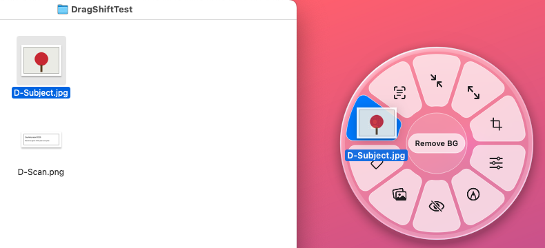

# Orbit

Convert and edit files on your Mac without opening an app. Start dragging any file in Finder, press **Shift**, and drop it on an action.



## Download

**[Get the latest release](../../releases/latest)**

- Apple Silicon (M1 or later): `Orbit-mac-apple-silicon.dmg`
- Intel: `Orbit-mac-intel.dmg`

Open the `.dmg` and drag **Orbit** into Applications. The first time, macOS blocks it because it isn't from the App Store: go to **System Settings → Privacy & Security** and click **Open Anyway**.

## Use it

1. Start dragging any file in Finder.
2. Press **Shift**. Orbit opens under your cursor.
3. Drop the file on an action. Tap **Shift** again to switch between **Convert** and **Tools**.

Results are saved next to the original, which is never changed. Everything runs on your Mac. Nothing is uploaded.

## What it does

- **Convert:** images (JPG, PNG, WebP, HEIC, TIFF, AVIF, BMP, GIF, ICO) to each other or to PDF; PDFs to images, Word or text; Word and text files to PDF.
- **Tools:** Compress, Resize, Crop, Edit, Annotate, Redact, Add BG, Metadata. For PDFs: Split, Rotate, Merge, Protect, Extract.
- **Remove BG** and **Copy Text**, powered by Apple's on-device Vision.

## Credits

Built by Ronith on GitHub: GitHub Actions builds and tests every release on real Macs. Based on [DragShift](https://github.com/llamaboi55/DragShift) by llamaboi55.

## Run from source

```bash
pip install -r requirements.txt
python -m dragshift
```

Tests: `python -m pytest -q`
